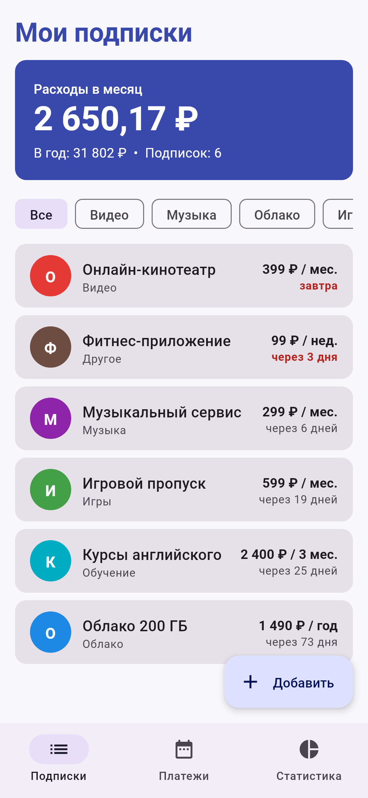
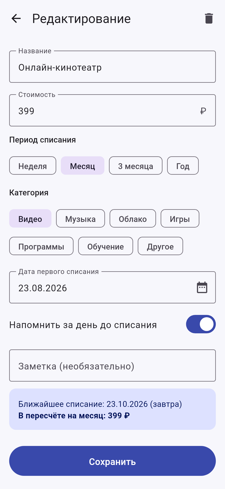
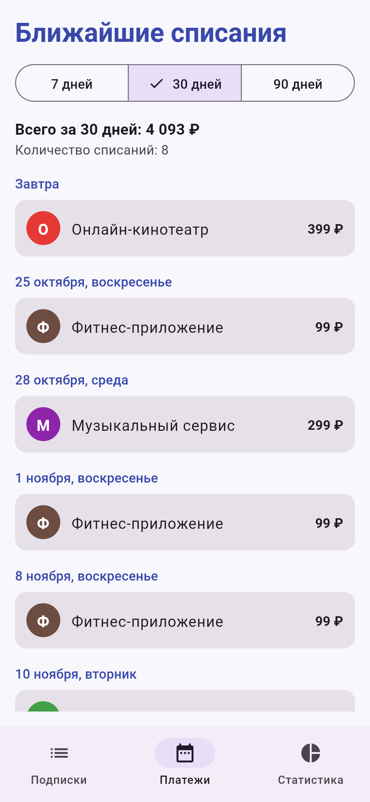
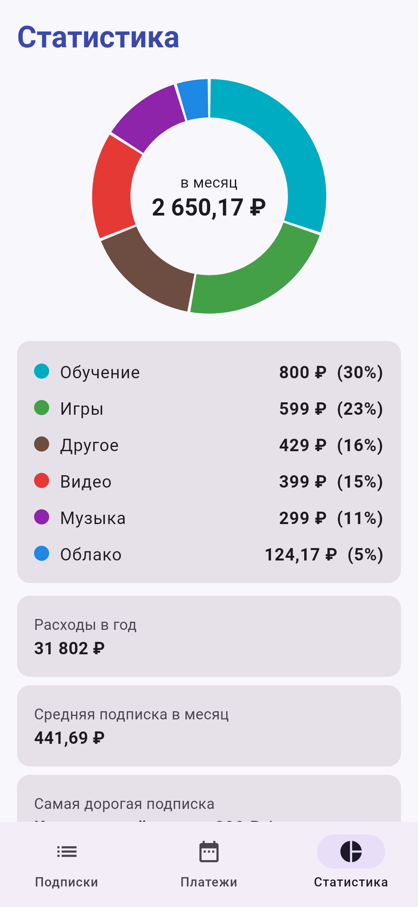

# Трекер подписок

Мобильное приложение для Android на Kotlin + Jetpack Compose: учёт подписок, расходы в месяц и в год,
календарь ближайших списаний, статистика по категориям и напоминание за день до списания.

| Подписки | Редактирование | Платежи | Статистика |
|---|---|---|---|
|  |  |  |  |

## Возможности

- **Подписки** — список подписок, отсортированный по ближайшему списанию; итоговые расходы в месяц и в год;
  фильтр по категориям; кнопка «Заполнить примерами» для пустого списка.
- **Добавление и редактирование** — название, стоимость, период (неделя / месяц / 3 месяца / год), категория,
  дата первого списания (календарь), напоминание, заметка; проверка ввода; удаление с подтверждением.
- **Платежи** — ближайшие списания на 7, 30 или 90 дней, сгруппированные по дням, с общей суммой.
- **Статистика** — кольцевая диаграмма расходов по категориям, расходы в год, средняя и самая дорогая подписка.
- **Уведомления** — WorkManager раз в сутки (и при запуске приложения) проверяет списания на завтра.

## Технологии

Kotlin 2.0, Jetpack Compose (Material 3), Navigation Compose, ViewModel + StateFlow, Room (SQLite), WorkManager.
minSdk 26, targetSdk/compileSdk 35.

## Запуск

1. Android Studio → **File → Open** → выбрать папку репозитория.
2. Дождаться синхронизации Gradle (зависимости скачаются автоматически).
3. Выбрать эмулятор или устройство и нажать **Run ▶** (конфигурация `app`).

Из командной строки: `./gradlew assembleDebug` (APK появится в `app/build/outputs/apk/debug/`).

## Структура

```
app/src/main/java/com/example/subscriptiontracker/
├── MainActivity.kt             — точка входа, запрос разрешения на уведомления
├── TrackerApplication.kt       — канал уведомлений и планирование напоминаний
├── SubscriptionViewModel.kt    — общая ViewModel, проверка ввода
├── data/                       — модель Subscription, Room (AppDatabase, SubscriptionDao, Converters)
├── ui/                         — экраны Compose и навигация
└── notify/                     — ReminderWorker и NotificationHelper
```

Отчёт по лабораторным работам: [`docs/Отчет_Трекер_подписок.docx`](docs/Отчет_Трекер_подписок.docx).
